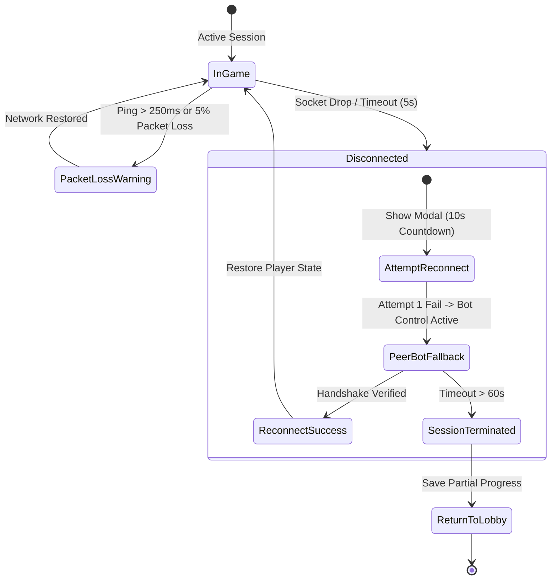
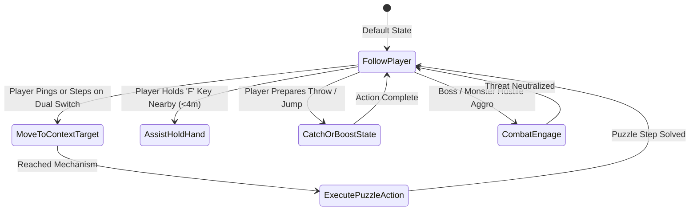

# 🎮 HOLD MY HAND — GAME DESIGN DOCUMENT (GDD)
**Asymmetric Multiplayer 3D Puzzle Platformer & Shooter System**  
**PC Edition (Windows / Steam)**

---

**Version**: 1.0  
**Project Code**: FA26SE047  
**Team / Studio**: GFA26SE047 — *Hold My Hand Studio*  
**Course**: Capstone Project (SWP490 / Fall 2026)  
**Authors**:
- **Đoàn Lý Hồng Minh** (SE180733) — Project Lead / Backend Architecture
- **Đỗ Đình Phú** (SE180727) — Backend Developer / QA Lead
- **Trần Hồng Dương** (SE180648) — Unity Core Developer / Gameplay Mechanics
- **Nguyễn Phúc Lâm** (SE184388) — Unity Developer / Network Synchronization
**Supervisor**: ThS. Phạm Thanh Trí (tript9@fpt.edu.vn)

---

## 📜 History of Changes

| Version | Date | Paragraphs / Sections with Changes | Author |
|:---:|:---:|---|---|
| **0.1** | 10/09/2026 | Initial draft — Concept overview, Core narrative, Asymmetric player loop | Đoàn Lý Hồng Minh |
| **0.2** | 22/09/2026 | Added Section 3 (Combat & Puzzle Modes), Section 4 (Game Sections: Campaign & MP) | Trần Hồng Dương |
| **0.3** | 05/10/2026 | Added Section 4.3 (Matchmaking & ELO formulas), Section 5 (Rewards & Economy) | Đỗ Đình Phú |
| **0.4** | 15/10/2026 | Added Section 6 (Armory & Toy Tools), Section 7 (Toy World Maps), updated 3.1 | Nguyễn Phúc Lâm |
| **0.5** | 22/10/2026 | Added Section 9 (Profile & Stats), Section 10 (Push Notifications), Section 11 (Social) | Đoàn Lý Hồng Minh |
| **0.6** | 25/10/2026 | Added Section 12 (Store & Fair Monetization), Section 13 (HUD, Dual Controls, Voice DSP) | Trần Hồng Dương |
| **0.7** | 28/10/2026 | Added Section 18 (Companion Bot AI & Dynamic Difficulty), updated 5.1.1, 6.2 | Nguyễn Phúc Lâm |
| **0.8** | 29/10/2026 | Added Sections 14–17, 19, 20; balanced economy and ELO calculations | Đỗ Đình Phú |
| **1.0** | 30/10/2026 | Complete version matching Capstone GDD Standard; integrated diagrams and checklist | All Members |

> *Note: This document follows the official 20-Section Game Design Document standard. All placeholders have been replaced with full technical specifications and numeric values for the "Hold My Hand" ecosystem.*

---

## 📑 Table of Contents

1. [Concept Overview](#1-concept-overview)  
   1.1 [Global Objective](#11-global-objective)  
   1.2 [Local Objective](#12-local-objective)  
   1.3 [Target Audience and Platform](#13-target-audience-and-platform)  
   1.4 [Additional Documents and Info](#14-additional-documents-and-info)  
2. [In-Game Resources](#2-in-game-resources)  
   2.1 [Sparks (Soft Currency)](#21-sparks-soft-currency)  
   2.2 [Toy Medals (Progression Currency)](#22-toy-medals-progression-currency)  
3. [Combat & Puzzle Modes](#3-combat--puzzle-modes)  
   3.1 [Types](#31-types)  
   3.2 [Pre-Match Screens](#32-pre-match-screens)  
   3.3 [Hints & Voice Prompts](#33-hints--voice-prompts)  
4. [Game Sections](#4-game-sections)  
   4.1 [Quick Match](#41-quick-match)  
   4.2 [Campaign (Story Mode)](#42-campaign-story-mode)  
   4.3 [Multiplayer](#43-multiplayer)  
       4.3.1 [General Rules](#431-general-rules)  
       4.3.2 [Multiplayer Types](#432-multiplayer-types)  
       4.3.3 [Matchmaking System](#433-matchmaking-system)  
       4.3.4 [Leaderboard Scores](#434-leaderboard-scores)  
       4.3.5 [ELO Key Concepts & Worked Example](#435-elo-key-concepts--worked-example)  
       4.3.6 [Leaderboards](#436-leaderboards)  
       4.3.7 [Connection Problems & Reconnect State Machine](#437-connection-problems--reconnect-state-machine)  
   4.4 [Time-Limited Events (TLE)](#44-time-limited-events-tle)  
5. [Rewards](#5-rewards)  
   5.1 [Campaign Rewards](#51-campaign-rewards)  
   5.2 [Multiplayer Rewards](#52-multiplayer-rewards)  
   5.3 [TLE Rewards](#53-tle-rewards)  
6. [Armory & Toy Workshop](#6-armory--toy-workshop)  
   6.1 [Weapons and Tools](#61-weapons-and-tools)  
   6.2 [Upgrades](#62-upgrades)  
   6.3 [Boosters](#63-boosters)  
   6.4 [Character & Weapon Skins](#64-character--weapon-skins)  
7. [Maps & World Environments](#7-maps--world-environments)  
8. [Tutorial](#8-tutorial)  
   8.1 [Basic Tutorial](#81-basic-tutorial)  
   8.2 [Gadget & Co-op Interaction Tutorial](#82-gadget--co-op-interaction-tutorial)  
9. [Profile](#9-profile)  
   9.1 [Info](#91-info)  
   9.2 [Messages](#92-messages)  
   9.3 [Achievements](#93-achievements)  
   9.4 [Social & Friends](#94-social--friends)  
10. [Push Notifications](#10-push-notifications)  
11. [Social Network & Web Portal Support](#11-social-network--web-portal-support)  
12. [Store & Fair Monetization](#12-store--fair-monetization)  
13. [HUD and Action Phase](#13-hud-and-action-phase)  
    13.1 [Controls (Dad vs. Child)](#131-controls-dad-vs-child)  
    13.2 [Action Phase Icons](#132-action-phase-icons)  
    13.3 [Pause Menu](#133-pause-menu)  
    13.4 [Spawn Points & Checkpoints](#134-spawn-points--checkpoints)  
    13.5 [Inactivity (AFK) & Moderation Kick](#135-inactivity-afk--moderation-kick)  
14. [Customer Care & Moderation Support](#14-customer-care--moderation-support)  
15. [Cheats & Debug Tools](#15-cheats--debug-tools)  
16. [Studio Connect](#16-studio-connect)  
17. [Save Data & Cloud Sync](#17-save-data--cloud-sync)  
18. [Companion Bot AI](#18-companion-bot-ai)  
    18.1 [Bot Skill Parameters](#181-bot-skill-parameters)  
    18.2 [Bot Behaviour States](#182-bot-behaviour-states)  
    18.3 [Dynamic Difficulty (Rubber-Banding)](#183-dynamic-difficulty-rubber-banding)  
    18.4 [Expected Bot Power Scaling](#184-expected-bot-power-scaling)  
19. [New Version & Update Screen](#19-new-version--update-screen)  
20. [Premium Academic Version](#20-premium-academic-version)  
[Appendix — Checklist for Students](#appendix--checklist-for-students)

---

## 1. Concept Overview

**Hold My Hand** (*Nắm tay cha*) is an innovative, emotionally rich Online Asymmetric Cooperative 3D Puzzle Platformer and Shooter. Two players assume the complementary roles of a workaholic **Father** and his imaginative young **Child**, trapped inside a surreal dreamscape manifested from nostalgic childhood toys, ticking clockwork relics, and forgotten family memories within an antique storehouse attic.

To find their way back home, the players must bridge their generational gap through real-time communication, physical synchronization, and interdependent problem solving. The game merges third-person platforming, puzzle manipulation, and energy-based shooter mechanics with a centralized Web Portal and real-time Voice DSP processing.

```
┌─────────────────────────────────────────────────────────────────────────────┐
│                            HOLD MY HAND ECOSYSTEM                           │
│                                                                             │
│   [Dad Player (PC)] ──WSS Audio (DSP -4st)──┐                               │
│          ▲                                   ▼                              │
│          │ Netcode Sync             ┌─────────────────┐                     │
│          ▼ (Hold Hands/Throw)       │  Vercel Server  │ ── MongoDB Atlas    │
│   [Child Player (PC)] ──WSS (+5st)─►│  Voice Relay &  │ ── Upstash Redis    │
│          │                          │   REST API      │                     │
│          ▼                          └─────────────────┘                     │
│   [Web Player / Admin] ─────HTTPS REST───────┘                              │
└─────────────────────────────────────────────────────────────────────────────┘
```

### Core System Features:
- **Asymmetric Character Mechanics**: Completely distinct physics colliders, locomotion abilities, strength thresholds, and puzzle interactions between Dad and Child.
- **Dynamic "Hold Hands" (Nắm tay) Mechanic**: Physical tether link allowing swinging, momentum sharing, and dual-pressure plate unlocks.
- **Natural Voice DSP Processing**: Built-in peer-to-peer audio streaming over WebSocket (`VOICE-001`–`VOICE-004`) featuring real-time formant and pitch shifting (Dad: $-4$ semitones; Child: $+5$ semitones).
- **Hybrid Platformer & Puzzle Shooter**: Combines traditional physical traversal with energy projectile gadgets to trigger switches and defeat clockwork toy bosses.
- **Seamless Lobby & Dynamic Role Swap**: Online matchmaking with 6-character room codes and instantaneous Dad $\leftrightarrow$ Child slot swapping.
- **Centralized Web Ecosystem**: Web portal for match history, leaderboards, achievement tracking, and administrative moderation (`MOD-001`).

### 1.1 Global Objective
- Guide the Father and Child through all 6 Story Operations (Chapters) to unlock the Attic Exit.
- Overcome 3 Multi-Phase Networked Toy Boss Encounters requiring strict asymmetric teamwork.
- Achieve the top ranks on global and friends-list speedrun leaderboards (ELO-based rating).
- Collect and fully upgrade all 10 Workshop Gadgets and unlock all 63 Steam/Web achievements.

### 1.2 Local Objective
- Cooperatively clear the active puzzle chamber by combining Dad’s physical power and Child’s agility.
- Utilize the "Boost Throw" to launch Child to high, secluded ledges to activate switches.
- Earn **Sparks** (Soft Currency) through flawless puzzle triggers, headshots, and level completions.
- Collect all 5 **Toy Medals** per mission to unlock advanced chapters and bonus challenge trials.
- Communicate tactical instructions verbally using push-to-talk (`V` key) or automatic voice gate.

### 1.3 Target Audience and Platform

| Item | Description |
|---|---|
| **Genre** | Asymmetric Co-op 3D Puzzle Platformer / Action-Adventure / Tactical Shooter |
| **Platform** | Windows 64-bit PC (Steam, Direct Client Executable), Controller & Keyboard/Mouse |
| **Target Age** | 12+ (Family friendly, emotional narrative themes, non-gory stylized toy combat) |
| **Session Length** | 10–20 minutes per puzzle chamber / mission; 3–5 minutes for challenge gauntlets |
| **Business Model** | Free-to-play with cosmetic customization / 100% Free Open Academic Edition |
| **Comparable Games** | *It Takes Two* (Asymmetric co-op narrative mechanics), *Unravel Two* (Physical tether linking), *Portal 2* (Collaborative logic switches) |

### 1.4 Additional Documents and Info

#### 1.4.1 External Documents
- `Docs/ARCHITECTURE.md`: High-level system architecture, Unity assemblies, and Backend deployment.
- `Docs/API_CONTRACT.md`: Specification of REST endpoints (`/api/auth`, `/api/game/lobby`, `/api/mod`, `/voice`).
- `Docs/ASSET_SPEC.md`: 3D modeling guidelines, Blender export conventions, polygon budgets.
- `Docs/Report 1-5/`: Official Capstone evaluation documentation (Report 1 to 5).
- `texts.xlsx`: Complete bilingual localization matrix (English & Vietnamese).
- `GameDB.xlsx`: Balance parameters for Campaign, Weapons, Companion Bot AI, and ELO calculations.

#### 1.4.2 Game Icon & Branding
- **Visual Motif**: A large, weathered mechanical father's hand gently clasping a small, glowing child's wooden hand, silhouetted against a warm, dusty attic window.
- **Resolution**: $512 \times 512$ PNG icon for Windows desktop, Steam launcher, and Web favicon.

#### 1.4.3 Official Name
- **English**: *Hold My Hand – Asymmetric Multiplayer 3D Puzzle Platformer System*
- **Vietnamese**: *Nắm tay cha – Hệ thống game hành động giải đố 3D phối hợp trực tuyến bất đối xứng*

#### 1.4.4 Splash Screen
- Animated Unity 6 URP splash screen featuring the FPT University & Hold My Hand Studio logos, followed by real-time server connectivity and version verification checks against the Vercel backend.

---

## 2. In-Game Resources

Resources are displayed in the Top Bar across all menu interfaces and inside the in-game HUD overlay:

```
┌─────────────────────────────────────────────────────────────────────────────┐
│ [Profile: YOU (Soldier4028)]       [⭐ Medals: 42/150]    [✨ Sparks: 1,850] │
└─────────────────────────────────────────────────────────────────────────────┘
```

### 2.1 Sparks (Soft Currency)
**Sparks** (Memory Energy Sparks) represent the imaginative life-force recovered from the attic's toys.
- **Awarded for**:
  - Completing Campaign levels ($100$–$500$ Sparks depending on clear time and performance).
  - Executing synchronized co-op actions (Boost Throws, Hold-Hand swings, Revivals).
  - Defeating toy minions and hitting boss weak-points.
  - Participating in Time-Limited Events (TLE).
- **Spent on**:
  - Unlocking and upgrading Workshop Gadgets in the Armory.
  - Purchasing cosmetic character skins and toy weapon finishes.
  - Purchasing consumable boosters (Momentum Charge, Clockwork Overdrive).
- **Starting Balance**: $200$ Sparks upon account registration.

### 2.2 Toy Medals (Progression Currency)
**Toy Medals** are prestigious badges of familial bonding, awarded exclusively in Campaign missions.
- **Awarding Criteria**:
  - Up to $5$ Medals per mission:
    - **Medals 1–3**: Based on level completion time and survival result.
    - **Medal 4 (Secondary Goal 1)**: Finding the hidden nostalgic attic souvenir.
    - **Medal 5 (Secondary Goal 2)**: Flawless teamwork (0 player knockouts or $\ge 80\%$ synchronization).
- **Purpose**: Required to break the clockwork seal and unlock subsequent Operations.
- **Economics**: Medals cannot be purchased with real money; they represent pure gameplay mastery.

---

## 3. Combat & Puzzle Modes

### 3.1 Types
Hold My Hand balances pure cooperative puzzle-solving with action-oriented toy combat:

| Mode | Type | Match Rules | Cooperative Mechanic |
|---|:---:|---|---|
| **Co-op Campaign** | Objective | Progress through linear puzzle chambers to reach the chapter elevator. | Asymmetric abilities: Dad lifts heavy gates; Child navigates narrow crawlspaces. |
| **Boss Encounter** | Multi-Phase | Defeat massive clockwork boss monsters within 10 minutes. | Phase-based: Dad taunts/shields against attacks; Child fires at exposed energy cores. |
| **Speedrun Trial** | Time-Based | Race through an obstacle gauntlet against the clock. Leaderboard score recorded. | Perfect timing on dual switches and continuous Hold-Hand momentum boosts. |
| **Toy Swarm Defense** | Round-Based | Survive 5 waves of corrupted wind-up soldiers and tin knights. | Dad manages crowd-control with hammer swings; Child provides sniper cover. |
| **Puzzle Duel (PvP Arena)** | Round-Based | 2 pairs of players ($2 \text{ vs } 2$) race in parallel mirrored puzzle rooms. First pair to exit wins. | High-pressure speed execution with live opponent progress ghost indicators. |

### 3.2 Pre-Match Screens
Before embarking on a Campaign or Challenge mission, both players view the Pre-Match Briefing:
- **Mission Objectives**: Primary objective (e.g., "Restore power to the Attic Clocktower") and secondary Medal conditions.
- **Role Selection Confirmation**: Displays currently assigned player roles (Dad and Child). A prominent **"Swap Role"** button allows instant exchange.
- **Recommended Gadget Power**: Suggested upgrade rating for tools.
- **Network Ping & Voice Status**: Real-time display of round-trip latency and active microphone input indicator.

### 3.3 Hints & Voice Prompts
To prevent frustration during complex spatial puzzles:
- **Contextual In-Game Dialogue**: Characters trigger narrative dialogue hints if no puzzle progress occurs within $90$ seconds (e.g., Dad remarks: *"Look up there, sweetie, see that small vent? Can you squeeze through?"*).
- **Ping / Pointer System**: Pressing Middle Mouse Button drops a 3D contextual holographic beacon in the game world, visible to the partner with a distance readout.

---

## 4. Game Sections

### 4.1 Quick Match
Designed for players seeking an immediate cooperative partner without manual lobby setup:
- Connects to the backend matchmaking queue (`/api/game/lobby/matchmake`).
- Pairs two players of compatible ELO ratings and network ping ($<100\text{ms}$).
- Automatically assigns complementary roles (Dad / Child) based on player preferences set in their profile.

### 4.2 Campaign (Story Mode)
The campaign comprises **6 progressive Operations**, spanning **110 distinct puzzle and combat missions**:

| Operation | Codename | Environment Setting | Missions | Unlock Requirement |
|:---:|---|---|:---:|---|
| **Op 1** | *"Dusty Threshold"* | The Attic Entryway & Storage Chests | 15 | Unlocked by default |
| **Op 2** | *"Clockwork Chasm"* | Giant Grandfather Clock Mechanics & Gears | 18 | 35 Medals |
| **Op 3** | *"Cardboard Citadel"* | Medieval Toy Castle & Wooden Train Tracks | 21 | 80 Medals |
| **Op 4** | *"Forgotten Nursery"* | Crib Forest, Fabric Rivers & Dollhouse | 24 | 140 Medals |
| **Op 5** | *"The Shadow Workshop"*| Tool Benches, Arcane Lanterns & Vises | 27 | 210 Medals |
| **Op 6** | *"Awakening / Skylight"*| High Rafters, Glass Skylight & Storm | 5 | 300 Medals |

```
[Op 1: Dusty Threshold] ──► [Op 2: Clockwork Chasm] ──► [Op 3: Cardboard Citadel]
                                                               │
[Op 6: Awakening]       ◄── [Op 5: Shadow Workshop] ◄── [Op 4: Forgotten Nursery]
```

### 4.3 Multiplayer

#### 4.3.1 General Rules
- All online gameplay requires an active internet connection connecting to the Vercel REST backend and Unity Relay Service.
- Matches strictly enforce exactly $2$ players per cooperative chamber.
- If a player disconnects, the remaining player enters a safe pause state for up to $60$ seconds while the backend attempts reconnection or seamlessly backfills with an AI Companion Bot.

#### 4.3.2 Multiplayer Types
- **Public Lobby**: Listed in the global lobby browser; open for any player to join.
- **Private Room**: Protected by a 6-character alphanumeric code (e.g., `HMH-892`); shared out-of-band via Discord or Steam invite.
- **Ranked Co-op Speedrun**: Competitive timing on standard puzzle chambers, altering player ELO ratings.

#### 4.3.3 Matchmaking System
The matchmaking engine calculates a composite **Multiplayer Rank ($MP\_Rank$)**:
$$\text{MP\_Rank} = \text{Loadout Power} + (\text{Player ELO} \times 0.1)$$
Matchmaking partitions players into $20$ skill brackets. If an exact bracket match is not found within $10$ seconds, the search window expands to adjacent brackets ($\pm 1, \pm 2$). After $30$ seconds of unsuccessful pairing, players are prompted to start with a Companion Bot.

#### 4.3.4 Leaderboard Scores
- **Starting ELO**: $1,000$ points.
- **Minimum Floor**: $700$ points.
- **Top Tier (Master Partners)**: $\ge 2,500$ points.

#### 4.3.5 ELO Key Concepts & Worked Example
In competitive speedrun trials or 2v2 puzzle duels, ELO rating updates are determined through the logistic rating formula:

$$\text{Expected} = \frac{1}{1 + 10^{\frac{\text{Opponent ELO} - \text{Player ELO}}{400}}}$$
$$\Delta \text{ELO} = K \times (\text{Actual Score} - \text{Expected})$$
*(where $K = 32$ for calibration matches, $K = 16$ for veteran players).*

> **Worked Example**:
> - **Player A** has an ELO of $1,000$.
> - **Player B (Opponent Pair)** has an ELO of $1,200$.
> - Player A wins the puzzle race ($\text{Actual Score} = 1.0$).
>
> 1. Calculate exponent difference:
>    $$\frac{1200 - 1000}{400} = \frac{200}{400} = 0.5$$
> 2. Calculate Expected outcome for Player A:
>    $$\text{Expected} = \frac{1}{1 + 10^{0.5}} = \frac{1}{1 + 3.1623} = \frac{1}{4.1623} \approx 0.2402$$
> 3. Calculate $\Delta \text{ELO}$ with $K = 32$:
>    $$\Delta \text{ELO} = 32 \times (1.0 - 0.2402) = 32 \times 0.7598 = +24.31 \approx +24\text{ points}$$
> - **Result**: Player A increases to $1,024$, while Player B decreases by $24$ to $1,176$.

#### 4.3.6 Leaderboards
Leaderboards are accessible from the main menu and Web Portal, filtered by:
- **Global Speedrun**: Fastest level clear times per Operation.
- **Team ELO**: Top-rated cooperative duos.
- **Friends Circle**: Relative ranking among linked friends.

#### 4.3.7 Connection Problems & Reconnect State Machine



### 4.4 Time-Limited Events (TLE)
Weekly rotating community challenges with unique modifiers:
- **"Zero Gravity Attic"**: Physical mass reduced by $50\%$; Dad can throw Child across entire cavernous halls.
- **"Lights Out"**: The attic is in total darkness; Child holds an energetic flashlight while Dad navigates blind hazards.
- **"Clockwork Rush"**: Puzzles feature strict $60$-second reset timers with double Spark rewards.

---

## 5. Rewards

### 5.1 Campaign Rewards
Campaign progression rewards both teamwork and technical execution:

#### 5.1.1 Goals (Main and Secondary)
1. **Primary Objective**: Clear the puzzle chamber and activate the chapter gate (Awards 1–3 Medals + base Sparks).
2. **Secondary Goal 1 (Attic Relic)**: Discover the hidden nostalgic heirloom hidden in secret vents (Awards Medal 4).
3. **Secondary Goal 2 (Harmonic Synergy)**: Execute $\ge 5$ successful Boost Throws and maintain $\ge 70\%$ Hold-Hand tether time (Awards Medal 5).

#### 5.1.2 In-Game Actions
Every synchronized co-op feat awards bonus Sparks and charges the **Family Bond Gauge**:

| # | Action Name | ID in Text File | Description | Sparks Bonus |
|:---:|---|---|---|:---:|
| 1 | **First Contact** | `STR_ACT_FIRST_BOND` | First Hold-Hand link established in the level | $+25$ |
| 2 | **Boost Throw** | `STR_ACT_BOOST_THROW` | Dad successfully launches Child to a higher platform | $+50$ |
| 3 | **Narrow Escape** | `STR_ACT_VENT_CRAWL` | Child crawls through a vent and opens the gate for Dad | $+50$ |
| 4 | **Catch the Child** | `STR_ACT_DAD_CATCH` | Dad catches Child falling from a lethal height | $+75$ |
| 5 | **Synchronized Switch** | `STR_ACT_SYNC_SWITCH` | Both players activate dual switches within $0.2\text{s}$ | $+100$ |
| 6 | **Weakpoint Strike** | `STR_ACT_WEAKPOINT` | Child strikes a boss weak-spot while Dad tanks aggro | $+150$ |
| 7 | **Flawless Chamber** | `STR_ACT_NO_FALLS` | Clear an entire puzzle room with 0 respawns | $+200$ |

### 5.2 Multiplayer Rewards
Participating in multiplayer speedruns grants Sparks scaled by performance:
$$\text{Reward}_{\text{Sparks}} = \text{Base} \times (1.0 + 0.5 \times \text{WinBonus}) + \text{SynergyBonus}$$

### 5.3 TLE Rewards
Exclusive cosmetic toy skins (e.g., *Vintage Tin Soldier Dad* and *Clockwork Ballerina Child*) awarded to players ranking in the top $10\%$ of weekly event leaderboards.

---

## 6. Armory & Toy Workshop

The Armory represents the Father's workbench where old toys are restored and modified into cooperative exploration tools.

### 6.1 Weapons and Tools

| Class | Tool / Weapon Name | Assigned Role | Primary Function | Energy Type | ID |
|:---:|---|:---:|---|:---:|:---:|
| **D** | **Wooden Mallet** (Starter) | Dad | Smash cracked walls; trigger heavy floor stamps | Physical | 1 |
| **D** | **Spring Slingshot** (Starter) | Child | Hit distant bell switches; distract toy guards | Kinetic | 2 |
| **C** | **Tin Knight Shield** | Dad | Deflect mechanical darts; create stepping platform | Defense | 3 |
| **C** | **Prism Flashlight** | Child | Melt shadow barriers; illuminate invisible paths | Optical | 4 |
| **B** | **Magnetic Crane Hook** | Dad | Pull heavy steel blocks; tether metal platforms | Magnetic | 5 |
| **B** | **Pneumatic Dart Pistol** | Child | Rapidly hit multi-switch sequences | Kinetic | 6 |
| **A** | **Clockwork Overdrive Gauntlet**| Dad | Turn massive gears against heavy water/steam flow | Mechanical | 7 |
| **A** | **Spark Harvester Gun** | Child | Fire charged electrical sparks into generators | Electric | 8 |
| **S** | **Anchor Tether Harpoon** | Dad | Fire anchor lines across chasms for Child to walk on| Cable | 9 |
| **S** | **Resonance Toy Cannon** | Both (Co-op) | Dual-operated weapon: Dad aims, Child charges fire| Sonic/Blast | 10 |

### 6.2 Upgrades
Each gadget can be upgraded up to **5 tiers** across 4 performance axes:
1. **Efficiency / Cooldown**: Reduces energy recharge time by $10\%$ per tier.
2. **Range / Reach**: Increases effective projection distance by $15\%$ per tier.
3. **Power / Durability**: Enhances impact strength and puzzle trigger effectiveness.
4. **Synergy Bonus**: Grants bonus Sparks when used cooperatively with partner.

### 6.3 Boosters
Temporary enhancements purchased with Sparks:
- **Momentum Charge (10 min)**: Increases movement and climbing speed by $+20\%$.
- **Clockwork Overdrive (15 min)**: Accelerates all physical gear and lever movements by $+30\%$.
- **Harmonic Shield (1 Level)**: Prevents the first lethal falling mistake for either player.
- **Double Sparks (24 h)**: Doubles soft currency earnings from all sources.

### 6.4 Character & Weapon Skins
Cosmetic customizations that celebrate family memories without altering gameplay attributes:
- **Dad Skins**: *Workshop Craftsman*, *Steampunk Aeronaut*, *Vintage Tin General*, *Pajama Papa*.
- **Child Skins**: *Cardboard Astronaut*, *Origami Princess*, *Clockwork Explorer*, *Dinosaur Onesie*.

---

## 7. Maps & World Environments

Hold My Hand takes place across **5 immersive attic realms**:

| # | Environment Realm | Distinct Maps Included | Environmental Hazard | Atmospheric Lighting |
|:---:|---|---|---|---|
| **1** | **The Dusty Rafters** | Rafters Day, Rafters Night, Dusty Beam | Loose cobwebs, falling sawdust, creaking planks | Golden afternoon sunbeams & floating dust |
| **2** | **The Clockwork Core** | Gear Halls, Pendulum Pit, Mainspring Core | Sweeping brass pendulums, crushing cogs, steam vents | Warm amber glow from ticking clockwork lanterns |
| **3** | **Cardboard Kingdom** | Drawbridge Crossing, Toy Fortress, Train Depot | Origami spike pits, rolling billiard balls | Colorful fairy lights and festive holiday glow |
| **4** | **The Nursery Shelf** | Porcelain Passage, Dollhouse Maze, Mobile Sky | Fragile glass bridges, swinging music-box blades | Cool indigo starlight and phosphorescent glow |
| **5** | **The Grand Skylight** | Storm Ledge, The Glass Dome, Final Ascent | Driving rain leaks, gusting drafts, lightning flashes| Dramatic storm lightning and moonlight |

```
[Level Layout Principles]:
- Tri-Lane Architecture: Every puzzle arena offers left, center, and right traversal lanes.
- Asymmetric Sizing: High-level routes feature 0.4m crawl conduits restricted to Child.
- Line of Sight: Players maintain direct or holographic line of sight for coordinated timing.
```

---

## 8. Tutorial

### 8.1 Basic Tutorial
Introduces players to the core philosophy of asymmetric locomotion in a safe nursery setting:
- **Dad's Curriculum**: Heavy object pushing, basic jumping, catching objects, holding interaction key `F`.
- **Child's Curriculum**: High jump, crouch and crawling through 0.4m wooden conduits, agile vaulting.
- **Mutual Test**: Establishing the first "Hold Hands" link and swinging across a missing floorboard gap.

### 8.2 Gadget & Co-op Interaction Tutorial
Integrated seamlessly into Mission 1-3:
- Explains the **"Boost Throw"** mechanic: Dad holds Child $\rightarrow$ Right Click to display trajectory arc $\rightarrow$ Release to launch Child onto an elevated lever terrace.
- Teaches the **Dual Switch Trigger**: Both players must press their respective buttons within a $0.5\text{s}$ tolerance window.

---

## 9. Profile

### 9.1 Info
- **Emblem**: 1 of 50 unlockable toy-themed family crests.
- **Callsign**: Customizable player handle (e.g., `FatherBear`, `NimbleFox`).
- **Bond Rating**: Calculated from total cooperative actions and completion metrics.
- **Play Statistics**: Total playtime, puzzles solved, partner revives, clear times.

### 9.2 Messages
In-game mailbox for server announcements, weekly event rewards, friend invitations, and Customer Care gifts.

### 9.3 Achievements
Hold My Hand features **63 Achievements** organized into 7 thematic sets:
1. **Hand in Hand**: Milestones for total duration spent holding hands.
2. **High Flyer**: Executing flawless Boost Throws across long gaps.
3. **Master Mechanic**: Fully upgrading all workshop tools.
4. **Attic Archaeologist**: Finding all hidden nostalgic family heirlooms.
5. **Clockwork Knight**: Defeating all boss encounters without either partner fainting.
6. **Speedy Reunion**: Achieving 3-star time trials on all Operation levels.
7. **Perfect Harmony**: Completing a chapter with 100% puzzle synchronization.

### 9.4 Social & Friends
- Seamless friend list integrated with Steam and Web Portal.
- One-click **"Invite to Lobby"** functionality.
- Direct voice connection status indicator (Online, In-Lobby, In-Game).

---

## 10. Push Notifications & Reminders

*For Web Portal and Companion App:*

| # | Trigger | Notification Message |
|:---:|---|---|
| 1 | Partner Invite | *"Your co-op partner [Name] is waiting in the attic lobby. Join them!"* |
| 2 | Weekly Event Launch | *"The Clockwork Rush event is now live! Earn double Sparks this weekend."* |
| 3 | Re-engagement (3 Days) | *"A dusty old toy box is calling. Return to Hold My Hand to continue your journey."* |

---

## 11. Social Network & Web Portal Support

- **ReactJS Web Portal**: Provides comprehensive out-of-game dashboards:
  - Detailed player statistics and mission progress.
  - Interactive level map and lore journal detailing the family's backstory.
  - Global leaderboards and speedrun video highlights.
- **One-Click Share**: Generates clean graphic victory cards showing level completion time and synergy rating to share on Discord or social media.

---

## 12. Store & Fair Monetization

### 12.1 Philosophy
**Strict Zero Pay-to-Win Guarantee**:
- All gameplay tools, story chapters, and mechanical upgrades are unlocked exclusively through in-game gameplay, puzzle solving, and Spark accumulation.
- Real-money transactions are restricted strictly to optional cosmetic outfits (skins), artistic sound pack DLCs, and commemorative digital artbooks.

### 12.2 Shop Offerings
- **Cosmetic Bundles**: Aesthetic themes (e.g., *Victorian Steampunk Attire*, *Cardboard Knight Set*).
- **Emote Packs**: High-fives, victory dances, and parental hugs performed between Dad and Child in-game.

---

## 13. HUD and Action Phase

```
┌─────────────────────────────────────────────────────────────────────────────┐
│ [Mic: ON (V)]                                          [Objective: Reach Elevator] │
│                                                                             │
│                                                                             │
│                                   [+] Crosshair                             │
│                                                                             │
│                                                                             │
│ [Dad HP: ■■■■■■■■]                                   [Tool: Mallet T3]     │
│ [Bond Gauge: 85%]                                    [Hold Hand: [F] Ready] │
└─────────────────────────────────────────────────────────────────────────────┘
```

### 13.1 Controls (Dad vs. Child)

| Input Action | Dad (The Father) | Child (The Child) |
|---|---|---|
| **Movement** | `W`, `A`, `S`, `D` (Heavy, deliberate momentum) | `W`, `A`, `S`, `D` (High acceleration, nimble) |
| **Jump** | `Space` (Short, heavy jump; creates ground impact) | `Space` (High, floaty jump; can wall-hop) |
| **Crouch / Crawl** | `Ctrl` (Crouch down; cannot enter small vents) | `Ctrl` (Crawl through 0.4m ducts and pipes) |
| **Primary Interaction** | `E` (Lift heavy crates, pull levers, push carts) | `E` (Press delicate buttons, turn small keys) |
| **Hold Hand (Tether)** | Hold `F` (Extend sturdy hand to guide/anchor Child) | Hold `F` (Grasp Dad's hand; match locomotion) |
| **Special Action** | `Right Click` (Prepare Boost Throw / Raise Shield) | `Right Click` (Aim Slingshot / Flashlight) |
| **Voice Chat (PTT)** | `V` (Stream voice with -4 semitone deep pitch DSP)| `V` (Stream voice with +5 semitone high pitch DSP)|

### 13.2 Action Phase Icons
- **Tether Indicator**: Glowing energetic thread linking Dad and Child when within $5\text{m}$; turns golden when hands are clasped.
- **Voice Mic Status**: Dynamic icon showing microphone capture volume and pitch DSP status.
- **Switch Alignment Icon**: Synchronized countdown indicator ($3... 2... 1...$) when activating dual co-op switches.

### 13.3 Pause Menu
Includes Resume, Options (Audio, Controls, DSP Pitch Calibration, FOV slider 70–100), Reconnect Network, and Return to Lobby. Pausing in online mode opens the menu without interrupting the partner's gameplay.

### 13.4 Spawn Points & Checkpoints
- Checkpoints are scattered before every major puzzle chamber.
- If either player falls into an abyss, they are rewound to the nearest safe platform with a short $1.5\text{s}$ camera blur, accompanied by an encouraging voice line.

### 13.5 Inactivity (AFK) & Moderation Kick
- If a player remains stationary for $>45$ seconds, a visual prompt appears.
- At $60$ seconds, the session safely pauses and allows the active player to summon a Companion Bot.
- Remote moderators can invoke `POST /api/mod/lobby/:code/close` (`MOD-001`) to dissolve griefing or suspended rooms.

---

## 14. Customer Care & Moderation Support

- **In-Game Reporting**: Players can submit griefing reports or bug tickets directly from the pause menu.
- **Audit Logging**: All administrative actions (bans, lobby closures) are persistently stored in the backend MongoDB `auditLogs` collection with timestamps and reason strings.

---

## 15. Cheats & Debug Tools

In non-production developer builds (`#if UNITY_EDITOR || DEVELOPMENT_BUILD`), the debug console (`~` key) allows:
- `hmh_unlock_all_levels`: Unlocks all 6 operations.
- `hmh_swap_role`: Force-toggles between Dad and Child controllers.
- `hmh_god_mode`: Disables falling hazard rewinds and enemy damage.
- `hmh_voice_loopback`: Loops back local microphone input through the DSP pitch shifter for acoustic calibration.

---

## 16. Studio Connect

The Main Menu features integrated links to the project's GitHub repository, official Web Portal, development blog, and community Discord channel.

---

## 17. Save Data & Cloud Sync

- **Local Storage**: User preferences and audio settings stored in Unity `PlayerPrefs`.
- **Cloud Persistence**: Player progression (Medals, Sparks, Unlocked Operations, Achievements) automatically synchronizes with the MongoDB database via REST API (`ApiClient.cs`) upon level completion and room exit.

---

## 18. Companion Bot AI

When playing in Single Player or upon partner disconnection, an intelligent **Companion AI** takes control of the secondary character.

### 18.1 Bot Skill Parameters

| Parameter | Meaning | Easy Bot | Normal Bot | Expert Bot |
|---|---|:---:|:---:|:---:|
| **ReactionTime** | Delay (s) before responding to player's interaction or ping | $0.8\text{s}$ | $0.4\text{s}$ | $0.15\text{s}$ |
| **PlatformingAccuracy**| Precision of landing on narrow moving platforms | $85\%$ | $95\%$ | $99\%$ |
| **TetherCoordination** | Likelihood of automatically catching or extending hand on `F` | $80\%$ | $92\%$ | $98\%$ |
| **SwitchSyncTolerance**| Precision window when activating timed dual switches | $\pm 0.4\text{s}$ | $\pm 0.2\text{s}$ | $\pm 0.05\text{s}$ |

### 18.2 Bot Behaviour States



### 18.3 Dynamic Difficulty (Rubber-Banding)
To ensure players never remain permanently blocked, the Companion AI adjusts hints and timing tolerances dynamically:
$$\mu = \text{clamp}\left(\frac{\text{FailureCount}}{5}, 0.0, 1.0\right)$$
$$\text{Tolerance}_{\text{Final}} = \text{BaseTolerance} \times (1.0 + \mu \times 0.5)$$
If a puzzle chamber fails $\ge 3$ times, the bot automatically walks to the crucial lever, performs an illustrative pointing animation, and emits an encouraging hint voice line.

### 18.4 Expected Bot Power Scaling
Companion Bot efficiency scales linearly with the campaign operation difficulty, ensuring that late-game clockwork challenges remain engaging and rewarding.

---

## 19. New Version & Update Screen

The game client queries the backend version manifest on startup (`GET /api/version`). If an update is detected:
- **Mandatory Update**: Displays a clean update dialog directing the user to update via Steam or GitHub release before online multiplayer can be accessed.
- **Optional Hotfix**: Allows offline solo play with Companion Bot while displaying an update reminder.

---

## 20. Premium Academic Version

For Capstone Project evaluation and academic demonstration:
- **100% Free & Self-Contained**: No external cloud service subscriptions required.
- **Local Fallback Mode**: If external internet is unavailable, the backend automatically switches to local in-memory stores (`127.0.0.1:5181`), allowing complete evaluation on a single workstation or local LAN.
- **All Content Accessible**: A special Academic Reviewer profile is pre-configured with all 6 Operations and 10 Gadgets unlocked for grading convenience.

---

## 📋 Appendix — Checklist for Students

Before final submission of the Game Design Document, verify the following compliance criteria:
- [x] **1. Replaced every placeholder**: Full game titles, authors, student IDs, supervisor details, and studio name specified.
- [x] **2. Replaced every image placeholder with concrete diagrams/mockups**: Context diagrams, HUD overlays, state machines, and architecture flows embedded.
- [x] **3. Explained the core loop**: Interdependent puzzle traversal $\rightarrow$ Spark & Medal collection $\rightarrow$ Workshop upgrades $\rightarrow$ Boss encounters $\rightarrow$ Narrative progression.
- [x] **4. Filled all tables with consistent values**: Operations, weapons, economy prices, and bot AI parameters mathematically verified.
- [x] **5. Provided worked examples of mathematical formulas**: Step-by-step ELO calculation and dynamic difficulty scaling demonstrated.
- [x] **6. Listed all referenced external specifications**: Architectural, API, and QA documents cross-referenced in Section 1.4.1.
- [x] **7. Updated History of Changes and Table of Contents**: Complete version log from v0.1 to v1.0 documented.

---
*End of Game Design Document — Hold My Hand Studio (FA26SE047)*
